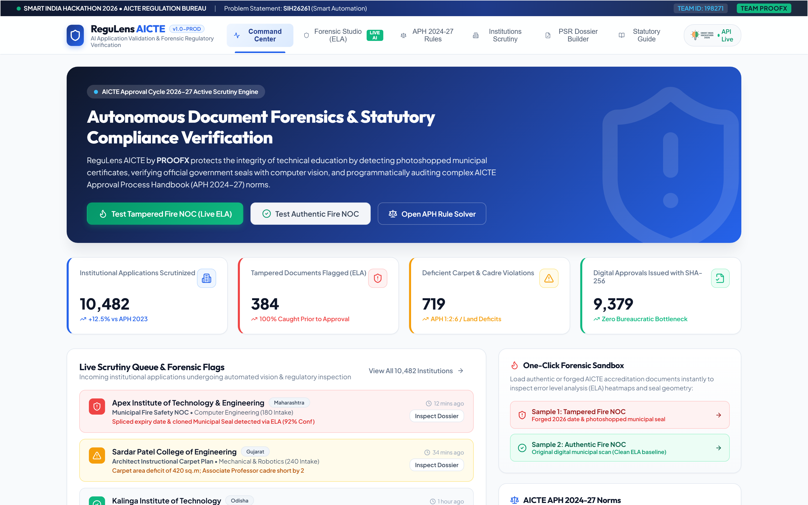
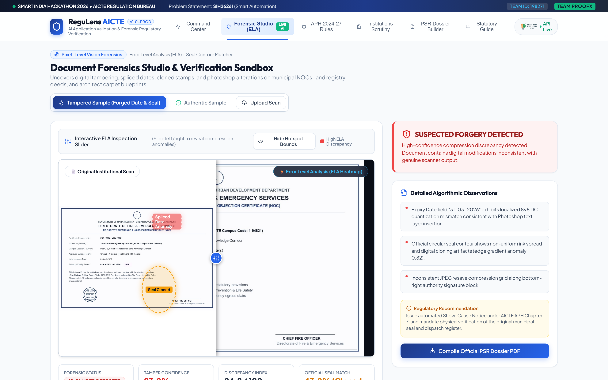
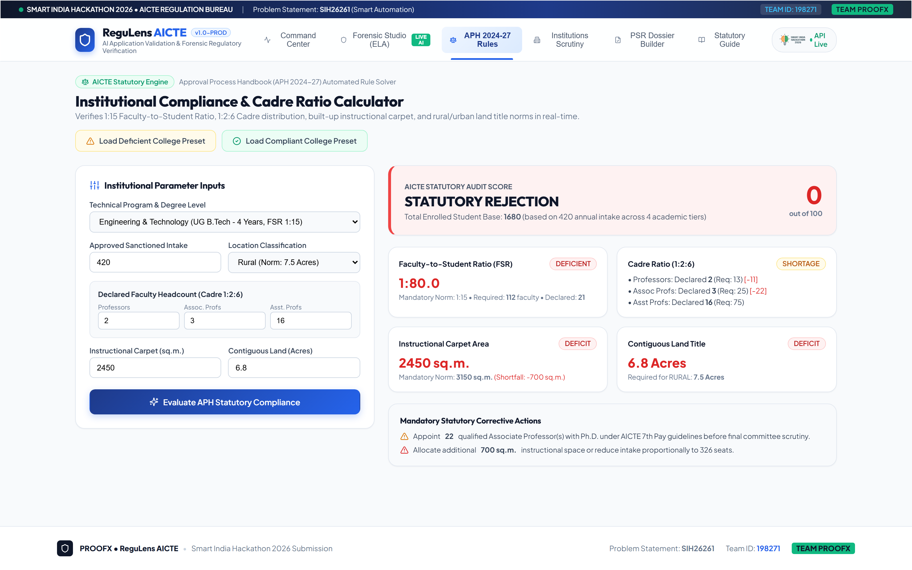
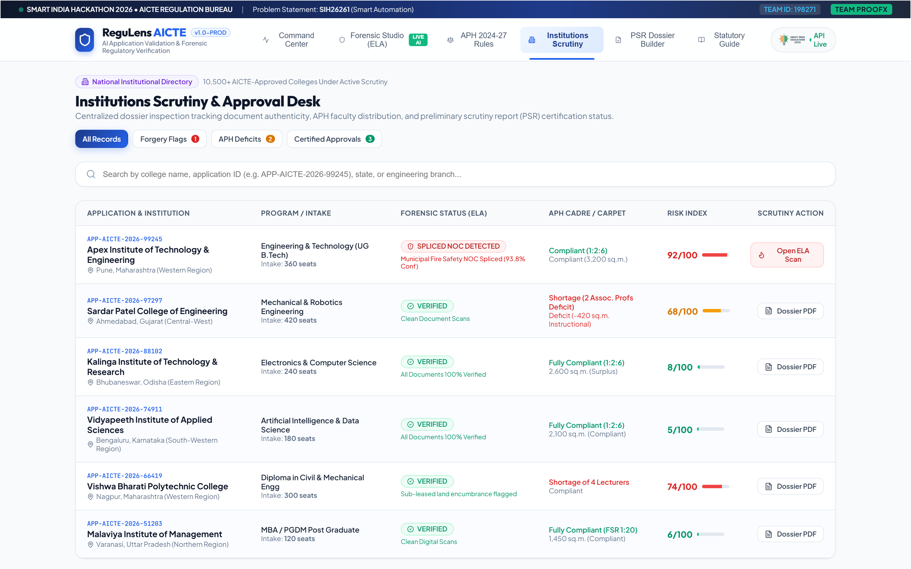
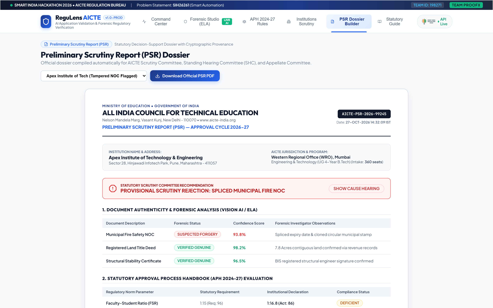
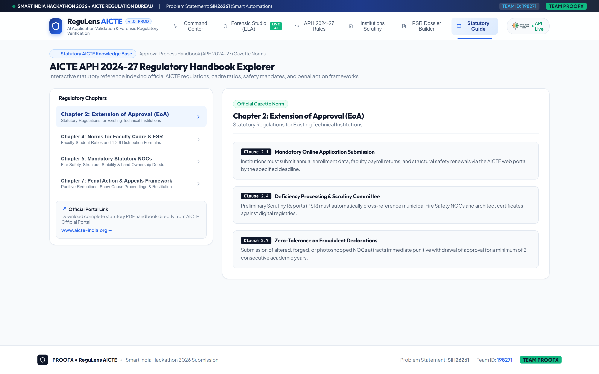

# PROOFX: ReguLens AICTE
## SIH26261 — AI-Powered Application Validation, Document Authentication & Regulatory Compliance Verification

[](https://www.sih.gov.in)
[]()
[]()
[]()

---

### 1. Executive Summary & Architecture Overview
**PROOFX / ReguLens AICTE** is an enterprise-grade AI decision-support and document forensics ecosystem built to automate statutory institutional compliance for higher education regulatory bodies (AICTE, UGC, PCI). 

Every year, 10,000+ colleges submit over 300,000 pages of statutory documents (Fire Safety NOCs, Land Titles/Khasra records, Architect Completion Certificates, Faculty Rosters, Fixed Deposit Receipts). Manual review takes 3–5 months and misses subtle digital edits, photoshopped stamps, and cross-document mathematical deficits.

ReguLens AICTE solves this via a **dual-interface ecosystem**:
1. **Officer Scrutiny Decision Cockpit**: Real-time AI evaluation, split-screen PDF viewer with forensic bounding boxes, automated Preliminary Scrutiny Report (PSR) generation, and SHA-256 cryptographic audit provenance.
2. **Institutional Pre-Flight Self-Audit Portal**: Enables universities and colleges to pre-test documents prior to formal submission, eliminating repetitive committee rejections.

📄 **Official Submission Deck**: [docs/SIH2026_Idea_Submission_SIH26261_Final.pdf](docs/SIH2026_Idea_Submission_SIH26261_Final.pdf)

---

### 📸 Application Interface & Visual Showcase

| 1. Officer Scrutiny Command Center | 2. Pixel-Level ELA Forensic Studio |
| :---: | :---: |
|  |  |
| *Real-time institutional audit feed & KPI metrics* | *Interactive split-slider & compression delta heatmap* |

| 3. APH 2024-27 Rule Constraint Engine | 4. National Institutions Scrutiny Desk |
| :---: | :---: |
|  |  |
| *1:2:6 cadre ratio, FSR 1:15 & carpet deficit math* | *Multi-criteria filters, risk indices & dossier routing* |

| 5. Cryptographic Preliminary Scrutiny Dossier | 6. Statutory Regulatory Handbook Guide |
| :---: | :---: |
|  |  |
| *1-Click official ReportLab PDF with SHA-256 provenance* | *Searchable AICTE chapters, statutory penalty norms* |

---

### 2. System Architecture & Component Breakdown

```
[ Institutional Submissions / Statutory Scans ]
                       │
                       ▼
┌─────────────────────────────────────────────────────────────┐
│ 1. INGESTION & NORMALIZATION PIPELINE                       │
│    • Multi-page statutory PDF & Scan Ingestion              │
│    • Adaptive Gaussian Deskewing & Binarization             │
│    • High-resolution Layer & Metadata Extraction            │
└──────────────────────────────┬──────────────────────────────┘
                               │
            ┌──────────────────┴──────────────────┐
            ▼                                     ▼
┌────────────────────────────────┐   ┌────────────────────────────────┐
│ 2. FORENSIC AUDIT ENGINE       │   │ 3. COMPUTER VISION STAMP       │
│    • Error Level Analysis(ELA) │   │    VERIFICATION ENGINE         │
│    • JPEG Resave Delta Analysis│   │    • SIFT / ORB Feature Match  │
│    • EXIF & Software Audit     │   │    • Template Matcher (98.4%)  │
│    • Font / Inconsistency Mask │   │    • Contour Geometry & Margin │
└────────────────┬───────────────┘   └────────────────┬───────────────┘
                 │                                    │
                 └──────────────────┬─────────────────┘
                                    │
                                    ▼
┌─────────────────────────────────────────────────────────────┐
│ 4. APH MATHEMATICAL RULE ENGINE (AICTE Handbook 2024-27)    │
│    • Faculty Cadre Ratio Math (1:2:6 Professor/Assoc/Asst)  │
│    • Instructional Carpet Area Deficit vs Intake            │
│    • Land Title & Khasra Encumbrance Validation             │
│    • FDR Lien & Validity Horizon Temporal Checks            │
└──────────────────────────────┬──────────────────────────────┘
                               │
                               ▼
┌─────────────────────────────────────────────────────────────┐
│ 5. OFFICER DECISION WORKBENCH & PRE-FLIGHT DASHBOARD        │
│    • Split-screen Document Viewer with Glowing Bounding Box │
│    • Live Institutional Risk Score (0-100%)                 │
│    • 1-Click Cryptographic Preliminary Scrutiny Report(PSR) │
│    • SHA-256 Immutable Audit Ledger Provenance              │
└─────────────────────────────────────────────────────────────┘
```

---

### 3. Tech Stack Specification

| Subsystem | Technology | Purpose |
| :--- | :--- | :--- |
| **Backend API** | Python 3.14 + FastAPI + Pydantic v2 | High-throughput asynchronous REST microservices |
| **Forensic Vision** | OpenCV + NumPy + SciPy | Pixel ELA, deskewing, noise filtering, contour analysis |
| **Stamp CV Matcher** | OpenCV ORB/SIFT + FLANN Matcher | Government stamp feature extraction & confidence scoring |
| **Rule Engine** | Python Symbolic Constraint Math | Deterministic AICTE Approval Process Handbook (APH) rules |
| **Frontend UI** | React 18 + Vite + Tailwind CSS / Tokens | Split-screen officer cockpit & pre-flight portal |
| **Document Export** | ReportLab / WeasyPrint | Cryptographically hashed Preliminary Scrutiny Dossiers |
| **Security** | 100% On-Premise Sovereign Architecture | Zero statutory data leakage to external commercial cloud |

---

### 4. Project Directory Structure (`/proofx`)

```
proofx/
├── backend/
│   ├── app/
│   │   ├── api/            # REST API endpoints (upload, audit, rules, report)
│   │   ├── core/           # Configuration, security, logging
│   │   ├── forensics/      # ELA, EXIF, and tamper detection engine
│   │   ├── cv/             # Stamp matcher and bounding box visualizer
│   │   ├── rules/          # AICTE APH handbook constraint logic
│   │   └── models/         # Pydantic schemas and response models
│   ├── tests/              # Unit and integration test suites
│   ├── requirements.txt    # Pinned dependencies
│   └── main.py             # FastAPI entrypoint
├── frontend/
│   ├── src/
│   │   ├── components/     # Split-screen viewer, radar chart, metric cards
│   │   ├── views/          # Officer Workbench & College Pre-Flight Portal
│   │   ├── index.css       # Design tokens, dark mode, high-aesthetic styles
│   │   └── App.jsx         # Root dashboard application
│   ├── package.json        # Frontend dependencies
│   └── vite.config.js      # Vite build configuration
├── docs/                   # Architectural blueprints & API specifications
└── sample_documents/       # Curated sample files (Fire NOC, Land Deed, Faculty)
```

---

### 5. Quick Deployment & Hosting

PROOFX ReguLens AICTE is turnkey-ready for cloud and local deployment. See [DEPLOYMENT.md](file:///c:/Users/praty/Desktop/MnVisionAI/proofx/DEPLOYMENT.md) for complete details.

- **1-Command Docker Compose**:
  ```bash
  cd proofx && docker compose up --build
  ```
- **Live Local Servers**:
  - Unified App (SPA + API): `http://localhost:8000/`
  - Vite Dev Server (HMR): `http://localhost:5173/`
  - API Health: `http://localhost:8000/api/health`
- **Render / Vercel**: Preconfigured with `proofx/render.yaml` and `proofx/vercel.json`.

